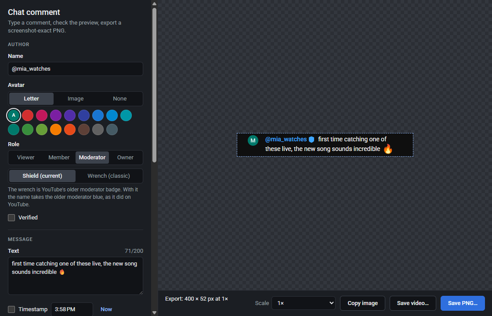
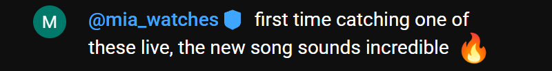
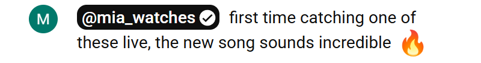

# YouTube Chat Comment

A desktop app that makes a picture of a YouTube **live-chat comment**: type a name and a message, and it
renders the comment exactly as YouTube's live chat does, then exports it as a PNG that matches a Snipping
Tool screenshot of that comment, or as a video of the message typing itself out.

<p align="center"></p>

Two exports, made at 2× and shown at half size:

<p></p>
<p></p>

It is meant for mock-ups, thumbnails, video edits and demos. It is not affiliated with or endorsed by
YouTube or Google, and a comment made with it should not be presented as something a real person said.

> **Disclaimer: this project is completely vibecoded.** All of the code, tests and documentation were
> written by Claude Code from plain-English requests; I directed it and checked the results, but I
> have not reviewed the code line by line. It works for me, and the tests pass, but treat it with the
> care that deserves: there may be bugs which I haven't noticed.

## Running it

Built and tested on Windows 11: the export matches a Windows screenshot, ClearType text and all. It should
also run from source on macOS and Linux, but that hasn't been tested there, and the packaged build is
Windows-only.

You need [Node.js](https://nodejs.org) 22.12 or newer, and an internet connection the first time a message
uses an emoji (the images come from Google's servers on demand).

```sh
npm install
npm start
```

Launch through `npm start` (or `node scripts/electron.js .`) rather than `npx electron .`: the launcher
removes `ELECTRON_RUN_AS_NODE`, which some tools (e.g. VS Code extensions) set and which would otherwise
make Electron run as plain Node.

### Build an executable

```sh
npm run dist
```

This writes two versions of the app to `dist/`:

- `YouTube-Chat-Comment-1.0.0-portable.exe`: one file you can keep and run anywhere. It unpacks itself
  each time it starts, so it opens a few seconds slower.
- `win-unpacked/`: the same app as a folder; `YouTube Chat Comment.exe` inside starts instantly.

The executable isn't code-signed, so on another PC Windows SmartScreen may ask before the first run
(More info → Run anyway). The version number comes from `package.json` and the icon from `build/icon.png`
(drawn from `build/icon.svg`).

## What you can set

- **Name and message**: the name is shown exactly as typed (YouTube shows `@handles`, and some older
  accounts still show a display name). Emoji in the message follow YouTube's own emoji list (Noto 15.1):
  everything on it, including symbols such as ♥ © ™, is drawn with the same Noto images YouTube uses, and
  newer emoji stay text, as they do on YouTube. Without internet the images fall back to your system's
  emoji font, and the preview says so.
- **Avatar**: a YouTube-style default avatar (a coloured square with the first letter, shown as a circle),
  or any picture: choose a file or drop it on the window. Like YouTube, the app draws avatars from a 32 px
  image at up to 1.33× scale and from a 64 px one above that. **None** crops the avatar out, as if your
  snip started just right of it: the image begins where the avatar ended and the line breaks don't change.
- **Role**: viewer, member (green name, plus your channel's badge image if you add one; YouTube has no
  stock member badge), moderator (blue name with the shield badge, or YouTube's classic wrench badge with
  its older blue) or owner (highlighted name), plus a verified tick.
- **Theme**: dark or light chat.
- **Timestamp**: hidden by default, as in YouTube's live chat; it follows the clock until you edit it.
- **Comment width**: line breaks depend on how wide the chat is. YouTube's standard chat gives 385 px rows;
  wider windows and theater mode give wider rows (400 px, the default). Adjust it until the line breaks
  match what you see on YouTube.
- **Margin**: extra chat background around the comment, like a looser snip.
- **Scale**: defaults to your display's scale factor, which is what a screenshot of your screen contains.
  Pick 1×, 1.5×, 2×… for other sizes.

Export with **Save PNG…** (Ctrl+S) or **Copy image** (Ctrl+Shift+C).

## Typing video

**Save video…** (Ctrl+Shift+S) exports an MP4 (H.264) in which the message types itself out one character
at a time (an emoji counts as one character), with the name, avatar and badges there from the start:

- **Typing speed**: 1–60 characters per second.
- **Start delay** and **Hold at end**: how long the empty comment shows before typing starts, and how long
  the finished comment stays.
- **Frame rate**: 30 or 60 fps.

**Preview typing** plays it in the preview. Every frame is captured exactly like the PNG export (same scale
and settings), so the video shows the same pixel-faithful comment; as the text wraps, the row grows
downwards, and the frame size is that of the finished comment.

## Read a comment from a screenshot

**Read a screenshot…** (Ctrl+O) fills in the name and message from a screenshot of a real live-chat
comment, so you can recreate it or start from it. You can also paste a snip straight from Snipping Tool
(Ctrl+V), or drop an image on the left half of the window, **Read the comment** (the right half makes it
the avatar). A new screenshot replaces one still being read. **Undo** (or Ctrl+Z) puts back what you had,
until you change the name or message yourself.

- It reads YouTube's desktop live chat in either theme at any display scale and browser zoom (it measures
  the scale from the avatar and the text), from a PNG or JPEG (WebP, AVIF, BMP and GIF open too). The snip
  can include the avatar, a timestamp, badges, an owner's name chip, the "more" button that appears under
  the pointer, extra background, or other comments around it (it reads the first complete one and says so,
  and warns when the comment it read is cut off by the edge of the snip).
- Emoji are recognised by matching them against YouTube's own emoji images, and accented letters (é, ö, ñ,
  å, ç…) by the shape of the accent.
- Text recognition runs on your computer ([Tesseract.js](https://github.com/naptha/tesseract.js) with its
  English model, bundled with the app); nothing is uploaded.
- Only the name and message are filled in. Theme, role, timestamp and the rest stay as you set them.

Every word is checked against the width it takes up in the screenshot (the app knows exactly how wide
YouTube draws each letter), which fixes most look-alike mistakes (`VVV` read as `VWV`, a miscounted
`GOOOOO`, a `:)` read as `)`); a capital I and a lowercase l are told apart by their height. Words it is
unsure of (no reading explains their width, or it had to choose between readings that fit) are named in
the status line to double-check: all of them when there are up to five, otherwise the first five and how
many more there are.

It gets most comments exactly right, but check what it fills in: handles that mix look-alike characters
(`Il1`, `O0o`) can still trip it up, and a screenshot that was resized after it was taken (made smaller to
send, say) loses the detail it relies on: about half of those come back exactly. Only Latin script is read
(other scripts need other OCR models). Text smaller than at 100 % on a 1× screen is often misread. Below
125 % only four accents (´ ` ¨ ˚) are told apart, and below 150 % curly quotes (’ “ ”) and the
ellipsis (…) look too much like ' " and ... to tell apart, so they come back as the straight ones. Comments
under videos (not live chat) and phone screenshots aren't supported.

## How it stays faithful

The comment is real YouTube markup styled by YouTube's own CSS, not an imitation:

- `src/comment/render.js` builds the same DOM YouTube's chat produces (elements, classes, attributes,
  even the zero-width spaces between the name and the message).
- `src/styles/youtube-chat.css` is the part of YouTube's chat stylesheet that applies to a message row,
  with its colour variables resolved for the dark and light themes; `src/styles/roboto.css` loads the
  same Roboto v48 font files YouTube's chat uses (bundled in `src/assets/fonts`).
- `src/stage/stage.html` reproduces the chat page around the row. The editor previews it, and export
  captures that same page from Chromium's compositor at the chosen scale (`electron/capture.js`).

## Tests

- `npm test`: unit tests (emoji handling, text limits, typing timing, HTML escaping, the generated markup,
  and the screenshot reader on the screenshots in `test/fixtures/screenshots` and on renders of comments it
  once got wrong in `test/fixtures/screenshot-scenarios`), and the checks of the screenshot corpus
  generator and of those fixtures (`test/screenshots/corpus.test.js`). Node can't decode JPEG, so the JPEG
  fixture is read from a lossless copy of its pixels beside it; if the JPEG changes,
  `node scripts/electron.js test/fixtures/screenshots/decode-jpegs.js` makes a new copy (the test says when).
- `npm run test:visual`: the golden test, which compares the app's output with real YouTube rows pixel by
  pixel. It needs a YouTube live-chat page saved by a browser, which isn't in the repository (it would
  contain other people's comments): open a live stream in Chrome or Edge, let the chat fill, then
  *Save page as… → Webpage, Complete* into `yt_example_page/`. The test finds the chat document
  (`saved_resource*.html` inside the saved `…_files` folder), screenshots real chat rows (plus owner,
  member, verified, timestamp, light-theme, classic-moderator and cropped-avatar variants made from them),
  renders the same comments with the app and compares the images. The cases in `CASES` refer to rows of
  the page the app was developed against (which row has a moderator, emoji, three lines…), so adjust them
  for your own page. Against that page, all 100 cases are identical at 1×, 1.25×, 1.5× and 2×. The test
  skips itself when no saved page is present.
- `node scripts/electron.js test/smoke/capture.js`: the capture pipeline (sizes at every scale, queueing,
  timeouts, crash recovery).
- `node scripts/electron.js test/smoke/app.js`: the whole app, run hidden: editing, saving, copying, a
  typing video (checked by reading the MP4 back), reading screenshots (pasted, opened and dropped), restoring
  saved settings, and the security checks.
- `node scripts/electron.js test/smoke/ocr.js`: text recognition in the app's renderer, offline and under
  its Content-Security-Policy. `node scripts/electron.js test/smoke/emoji-match.js`: emoji recognition on
  renders of YouTube's emoji at seven scales, JPEG-compressed and resized too, and that avatars, badges,
  text and channels' own emoji (flat tiles in skin tones and emoji colours among them) are not taken for
  emoji, with a margin to spare.
- `npm run test:screenshots -- test/fixtures/screenshots`: how well the screenshot reader does (exact names
  and messages, character error rate, broken down by theme, role, scale and so on). For a bigger test,
  `node scripts/electron.js test/screenshots/make-corpus.js` renders 400 varied comments (stacked, cropped,
  padded, JPEG-compressed, resized…) into `test/screenshots/corpus/`, which `npm run test:screenshots` reads
  by default. With a saved chat page (see above), `make-corpus.js --real` turns its rows into another set in
  `test/screenshots/corpus-real/`. `--min=90` makes the run fail below 90 % exact; `--only=` an id or a tag
  (`--only=transform:jpeg`) and `--limit=20` read only some of the cases; `--out=failed.json` saves the
  failed ones (for the real set, only inside its own folder or the temp folder: they hold real people's
  comments). Give options with `=` as shown: Electron refuses to start, without a word, when an argument
  that looks like a web address (letters and a colon, as a tag has) is followed by another.

YouTube's emoji list is bundled in `src/comment/youtube-emoji.js`; `node scripts/update-emoji.js [url]`
regenerates it from the list YouTube's chat loads. Then run `node scripts/update-emoji-signatures.js`, which
remakes the signatures the screenshot reader matches emoji against (`src/screenshot/emoji-signatures.js`;
it downloads each emoji image once, into `node_modules/.cache`): `npm test` fails until the two agree. After
an Electron update or a change to the fonts in `src/assets/fonts`,
`node scripts/electron.js scripts/update-roboto-metrics.js` re-measures the letter widths the reader checks
words against (`src/screenshot/roboto-metrics.js`; `--out=file` writes them elsewhere, to compare first).

## Project layout

```
electron/       main process: windows, IPC, the app:// protocol, capture
src/editor/     the editor window
src/stage/      the page the comment is rendered (and captured) in
src/comment/    markup, emoji, badges and avatars
src/screenshot/ reading a comment from a screenshot: layout analysis, OCR, emoji matching
src/styles/     YouTube's chat CSS and the Roboto font faces
test/           unit tests, smoke tests, the visual golden test and the screenshot corpus
docs/           the images in this README
```

## Licence

The app's own code is under the [MIT License](LICENSE). It also contains or uses:

- the markup and CSS rules of YouTube's live chat, reproduced in `src/comment/render.js` and
  `src/styles/youtube-chat.css` so that the comment renders identically; they belong to YouTube/Google;
- [Roboto](https://fonts.google.com/specimen/Roboto) (Google), bundled in `src/assets/fonts` under its
  own licence;
- [Noto Emoji](https://github.com/googlefonts/noto-emoji) images (Apache-2.0; its flag images are in the
  public domain), loaded at run time from Google's servers, the way YouTube's chat loads them. The app also
  contains signatures made from them (each image's average colours on an 8 × 8 grid, in
  `src/screenshot/emoji-signatures.js`, made by `scripts/update-emoji-signatures.js`), and the screenshots
  in `test/fixtures/screenshots` show some of them;
- [Electron](https://www.electronjs.org/) (MIT) and [Mediabunny](https://mediabunny.dev/) (MPL-2.0), which
  encodes the MP4;
- [Tesseract.js](https://github.com/naptha/tesseract.js) and its WebAssembly build of Tesseract
  (Apache-2.0), which read screenshots, with Tesseract's English model (from tessdata, Apache-2.0; packaged
  as `@tesseract.js-data/eng`, MIT). That build also contains
  [Leptonica](https://github.com/DanBloomberg/leptonica) (BSD-2-Clause) and the image libraries it is built
  with, each under its own permissive licence: zlib, libpng, libtiff, libwebp and the Independent JPEG
  Group's libjpeg (this software is based in part on the work of the Independent JPEG Group).
